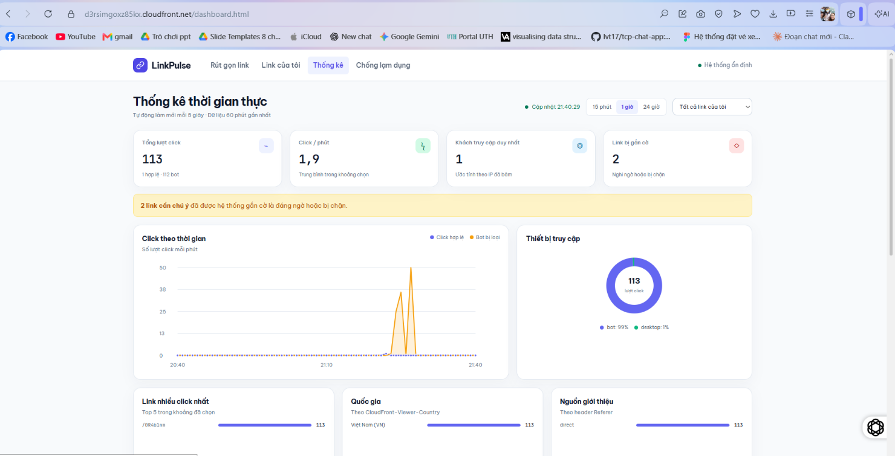
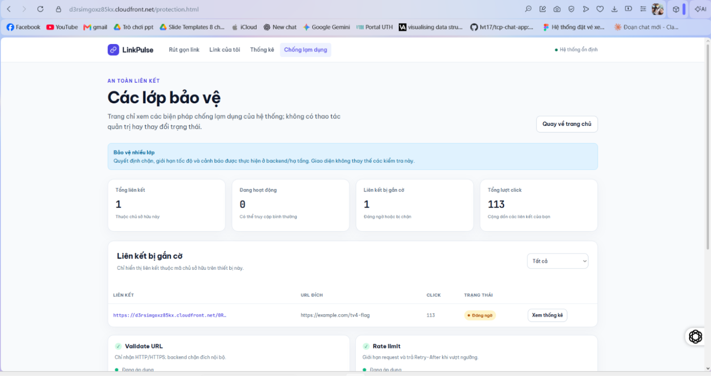
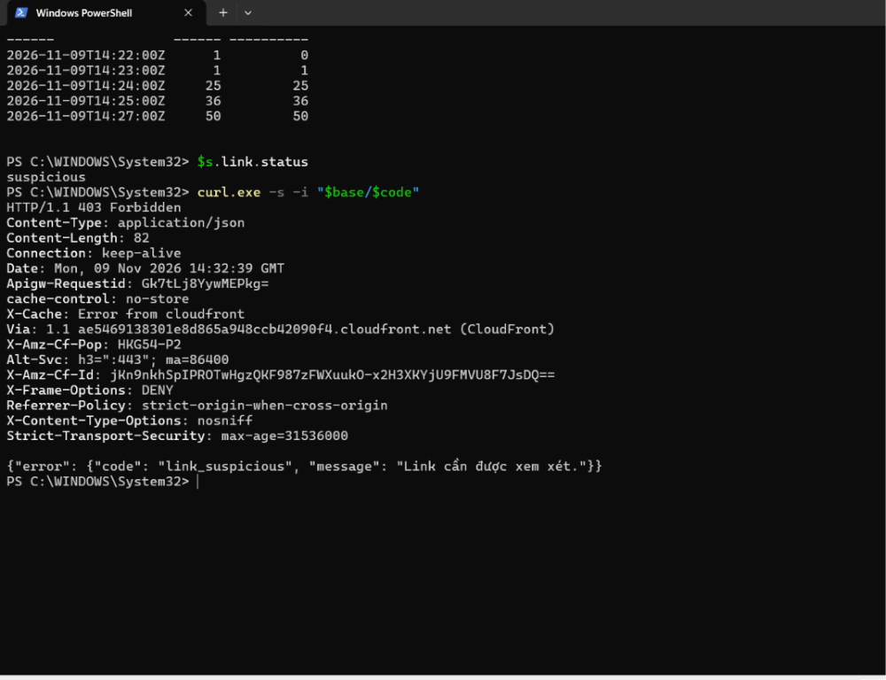

# Demo gắn cờ lạm dụng

## Mục tiêu và điều kiện

Xác nhận rằng click bot được tổng hợp theo phút UTC và link được gắn cờ khi đạt ngưỡng. Trong `backend/template.yaml`, giá trị mặc định là `SpikeClicksPerMinute = 300` và `BotMinClicks = 50`; `backend/src/linkpulse/config.py` đọc chúng thành `spike_clicks_per_minute` và `bot_min_clicks`, với `bot_ratio` mặc định là `0.8`.

`backend/src/linkpulse/abuse.py`, hàm `evaluate`, nhận item thống kê của một phút. Nếu `clicks >= spike_clicks_per_minute`, lý do gắn cờ là `click_spike`; nếu không, link bị gắn cờ `bot_traffic` khi `clicks >= bot_min_clicks` và `bots / clicks >= bot_ratio`. Handler stream thực tế nằm ở `backend/src/handlers/process_clicks.py`; `process_events` tổng hợp theo phút, cập nhật item rồi gọi `evaluate`.

Các ngưỡng mặc định `SpikeClicksPerMinute = 300` và `BotMinClicks = 50` đã được xác nhận cho bản đang deploy của lần demo này. Kết quả quan sát được khớp với ngưỡng 50 bot trong phút.

## Các bước đã làm và lệnh

Ngày 2026-11-09 UTC, dùng link mã `0R4b1nm`, URL demo `https://d3rsimgoxz85kx.cloudfront.net/0R4b1nm`, đích `https://example.com/tv4-flag`:

1. Lần đầu gửi 60 request liên tiếp bằng curl, không theo redirect và giữ User-Agent mặc định. Lần chạy không bắt đầu đúng đầu phút; có thêm một lần `curl -i` kiểm tra, nên các bucket lần lượt ghi nhận 25 click ở phút 14:24 và 36 ở phút 14:25. Link vẫn `active` và các request vẫn trả 302.
2. Chờ đến đầu phút 14:27 rồi gửi 80 request bằng curl trong 50 giây. 50 request đầu trả 302; sau khi đạt ngưỡng, 30 request tiếp theo trả 403.
3. Sau 15 giây gọi `GET /api/stats/0R4b1nm`. Kết quả tổng là `total_clicks = 113`, `bot_clicks = 112`; item phút 14:27 ghi 50 click và 50 bot click.
4. Kiểm tra trạng thái link và gọi `curl.exe -i` lên link đã gắn cờ. Lúc 14:32:39 GMT nhận HTTP 403 và JSON lỗi `link_suspicious`.

Thông tin được cung cấp mô tả các lệnh và tùy chọn đã dùng, nhưng không có nguyên văn lệnh vòng lặp; tài liệu không suy đoán nội dung lệnh.

## Kết quả

### Timeline stats

| Bucket UTC ngày 2026-11-09 | Clicks | Bot clicks |
|---|---:|---:|
| 14:22 | 1 | 0 |
| 14:23 | 1 | 1 |
| 14:24 | 25 | 25 |
| 14:25 | 36 | 36 |
| 14:27 | 50 | 50 |
| **Tổng** | **113** | **112** |

### Mã HTTP trong lần chạy

| Lượt | Số request | Mã HTTP |
|---|---:|---:|
| Lần 1 | 60 request chính, cộng 1 request `curl -i` kiểm tra | Các request vẫn trả 302; số click được ghi nhận chia thành 25 và 36 ở hai bucket |
| Lần 2 | 50 request đầu | 302 |
| Lần 2 | 30 request tiếp theo | 403 |

Sau lần hai, `link.status = suspicious`. Phản hồi từ `curl.exe -i` lúc 14:32:39 GMT:

```text
HTTP 403
{"error": {"code": "link_suspicious", "message": "Link cần được xem xét."}}
```

Header `X-Cache: Error from cloudfront` xuất hiện cùng phản hồi 403; theo kết quả cung cấp, đây là CloudFront chuyển tiếp lỗi từ backend và response có `cache-control: no-store`.

### Ảnh

| Tên file trong `docs/screenshots/` | Nội dung cần chứng minh |
|---|---|
| [01-dashboard-flagged.png](./screenshots/01-dashboard-flagged.png) | Dashboard hiển thị tổng 113 lượt click, 112 bot, biểu đồ click và link bị gắn cờ. |
| [02-protection-flagged.png](./screenshots/02-protection-flagged.png) | Trang Chống lạm dụng hiển thị link đích `https://example.com/tv4-flag` ở trạng thái đáng ngờ. |
| [03-stats-bot-clicks.png](./screenshots/03-stats-bot-clicks.png) | Cửa sổ PowerShell cho thấy timeline, `link.status = suspicious` và phản hồi 403 JSON `link_suspicious`. |

### Xem ảnh

**Dashboard**



**Trang Chống lạm dụng**



**Stats và phản hồi 403**



Ảnh được sao chép từ ảnh đính kèm, không chỉnh sửa. Không đưa Account ID, tên bucket hoặc Distribution ID vào tài liệu.

## Quan sát và hạn chế

- Đây là kết quả của một lần chạy, chưa phải phép đo độ trễ chính thức. Quan sát lần chạy này cho thấy cờ bật ngay sau click thứ 50; 30 request sau trả 403 và không được đếm.
- Cách tính theo bucket phút cố định giải thích kết quả lần đầu: 25 click trong phút 14:24 và 36 trong phút 14:25 không bucket nào đủ 50. Ở lần hai, 50 click bot trong phút 14:27 đạt ngưỡng và kích hoạt cờ.
- `SpikeClicksPerMinute = 300` và `BotMinClicks = 50` là giá trị mặc định ở `backend/template.yaml` và là ngưỡng của bản đang deploy cho lần demo này.
- `total_clicks` 113 và `bot_clicks` 112 là số liệu cộng theo khoảng stats nêu trên; bucket 14:27 riêng có 50 click và 50 bot click.
- Ba ảnh bằng chứng đã được đưa vào `docs/screenshots/`; ảnh PowerShell có cả timeline, trạng thái và phản hồi 403.
- Chờ TV5 báo đã chụp xong phần của mình; trong thời gian đó giữ nguyên link bị gắn cờ, không gỡ và không xóa.

