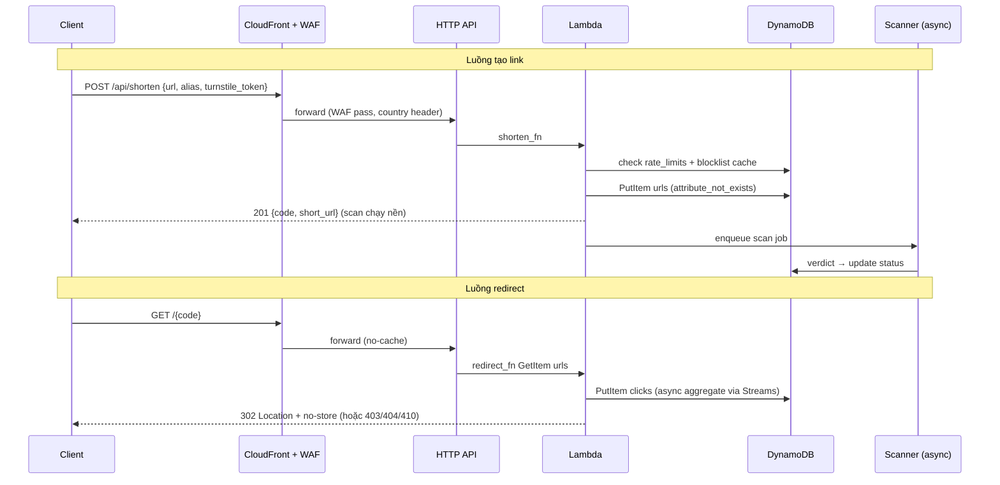

# Architecture v1 — Smart URL Serverless (LinkPulse)

> **Module:** TV5 tổng hợp từ TV1 (Backend Core), TV3 (Database DynamoDB), TV4 (Analytics/Redirect Worker) · **Issue:** Week 1 / #5
> **Stack:** `CloudFront + WAF (us-east-1) → API Gateway HTTP API → Lambda Python 3.11 → DynamoDB (urls, clicks, stats_agg, rate_limits, blocklist)` · Redirect `302 + no-store` · Analytics `DynamoDB Streams → click_processor`
> **Đọc cùng:** `docs/api_spec.yaml` (hợp đồng API), `docs/backend_research.md`, `docs/analytics_research.md`, `docs/click_event_schema.json`, `docs/threat_model.md`, `docs/security_research.md`
> **Ngày:** 27/10/2026 · **Trạng thái:** v1.0 — kiến trúc mục tiêu Week 2, tương thích prototype Week 1 (`backend/prototype.py`, `backend/template.yaml`)

---

## 1. Tổng quan & nguyên tắc

Hệ thống rút gọn liên kết serverless, tối ưu cho **redirect nhanh + rẻ** (traffic đọc lớn) và **tạo link an toàn** (traffic ghi nhỏ nhưng cần validate/anti-abuse nặng).

**Nguyên tắc v1:**

1. **Edge-first:** mọi request qua CloudFront; WAF chặn ở edge (`us-east-1`, scope `CLOUDFRONT`) trước khi chạm origin — vì HTTP API không gắn WAF trực tiếp (TV1 §2).
2. **Không cache redirect:** `GET /{code}` luôn `302 + Cache-Control: no-store`, CloudFront TTL 0 — mỗi click đều qua server để đếm (TV1 §4, TV4 analytics).
3. **Ghi cạnh tranh an toàn:** tạo mã bằng `PutItem + ConditionExpression attribute_not_exists(short_code)`; alias và mã tự sinh chung không gian khóa, không cấp lại mã đã xóa (TV1 §3).
4. **Validate 2 lớp + async scan:** kiểm tra đồng bộ rẻ ở `POST /shorten` (regex/host/own-domain/IP/DNS), quét độc hại nặng (GSB/URLhaus) chạy async + cache verdict (TV5 `security_research.md` §3).
5. **Analytics tách luồng nóng:** redirect chỉ `GetItem + ghi click` (< 100 ms); tổng hợp qua `DynamoDB Streams (NEW_IMAGE, INSERT-only) → click_processor → stats_agg`; dashboard poll `GET /stats` (TV4).
6. **Privacy by design:** chỉ lưu `ip_hash` (SHA-256 + salt KMS), không log IP/UA; API không trả PII.

**Region:** workload ở `ap-southeast-1` (Singapore) theo thống nhất nhóm; WAF Web ACL ở `us-east-1`; lưu ý tài khoản Free-plan kiểu mới bị cố định region theo project (TV1 §6.2) — member nào lệch region thì dùng profile riêng, không đổi region chung.

---

## 2. Sơ đồ kiến trúc tổng thể (Mermaid — render trực tiếp trên GitHub)

> File PNG export cho Draw.io/báo cáo: `docs/architecture.png` (xuất từ Mermaid bằng `mmdc` hoặc import `.mmd` vào Draw.io qua plugin Mermaid). Nguồn Mermaid chính là code dưới — sửa ở đây rồi export lại, không sửa PNG tay.

```mermaid
flowchart TB
    subgraph Client["Client — Browser / Bot / Attacker"]
        UI["Frontend Static<br/>S3 + CloudFront<br/>index.html, dashboard,<br/>error.html, warning.html<br/>Turnstile widget"]
    end

    subgraph Edge["AWS Edge — us-east-1 (WAF) + CloudFront"]
        WAF["AWS WAF Web ACL<br/>scope=CLOUDFRONT, us-east-1<br/>① IP Reputation<br/>② Rate-based /shorten 100/5'/IP<br/>③ Rate-based /code 1000/5'/IP<br/>④ KnownBadInputs + CRS"]
        CF["CloudFront Distribution<br/>Behaviors:<br/>/assets* → S3 (cache lâu)<br/>/api/* → HTTP API (no-cache)<br/>/{code} → HTTP API (TTL 0)<br/>+ Country header + HSTS"]
    end

    subgraph GW["API Gateway — HTTP API (ap-southeast-1)"]
        RT1["POST /api/shorten<br/>throttle 10 rps"]
        RT2["GET /{code}[?confirm=1]<br/>throttle 150 rps"]
        RT3["GET /api/stats, /stats/code<br/>GET /api/links, DELETE /links/code"]
    end

    subgraph Compute["Lambda — Python 3.11, 128 MB, timeout 5s"]
        LShort["shorten_fn<br/>validate → Turnstile verify<br/>→ blocklist/GSB-cache check<br/>→ conditional PutItem urls<br/>→ enqueue scan job<br/>429 + Retry-After"]
        LRedir["redirect_fn<br/>GetItem urls → check<br/>blocked/expired/max_clicks/suspicious<br/>→ 302 + no-store<br/>→ PutItem clicks + ADD stats"]
        LStats["stats_fn<br/>read stats_agg + urls<br/>→ StatsResponse JSON"]
        LScan["scanner_fn (async)<br/>GSB v4 + URLhaus<br/>→ verdict_cache/blocklist<br/>→ update urls.status"]
        LProc["click_processor<br/>Streams NEW_IMAGE INSERT-only<br/>→ aggregate stats_agg<br/>idempotent + partial-batch"]
    end

    subgraph Data["DynamoDB — on-demand + TTL + Streams"]
        TUrls[("urls<br/>PK short_code<br/>GSI owner-created<br/>status, long_url,<br/>expires_at, max_clicks")]
        TClicks[("clicks<br/>PK short_code#minute<br/>SK timestamp#rand<br/>TTL 90d, Streams ON")]
        TAgg[("stats_agg<br/>PK agg#code#granule<br/>total, bot, countries,<br/>devices, browsers, referrers")]
        TRate[("rate_limits<br/>PK ip#hash<br/>SK endpoint#bucket<br/>count + TTL 120s")]
        TBlock[("blocklist + verdict_cache<br/>PK sha256(url|domain)<br/>status + TTL")]
    end

    subgraph Ops["Ops & Anti-abuse"]
        SQS["SQS scan-queue + DLQ"]
        EB["EventBridge cron 6h<br/>re-scan top links"]
        CW["CloudWatch<br/>metrics + alarms<br/>WAF logs → S3"]
        BUD["AWS Budget $5/mo<br/>mail cả nhóm"]
        SSM["SSM SecureString/KMS<br/>salt, GSB key,<br/>Turnstile secret"]
    end

    UI -->|HTTPS GET/POST| WAF
    WAF -->|allow| CF
    CF -->|/api/shorten| RT1
    CF -->|/{code}| RT2
    CF -->|/api/*| RT3
    RT1 --> LShort
    RT2 --> LRedir
    RT3 --> LStats
    LShort --> TUrls
    LShort --> TRate
    LShort --> TBlock
    LShort -->|send message| SQS
    SQS --> LScan
    EB --> LScan
    LScan --> TBlock
    LScan --> TUrls
    LRedir --> TUrls
    LRedir --> TClicks
    LRedir --> TRate
    TClicks -->|Streams NEW_IMAGE| LProc
    LProc --> TAgg
    LStats --> TAgg
    LStats --> TUrls
    LShort -.->|read secret| SSM
    LRedir -.->|read salt| SSM
    LScan -.->|read GSB key| SSM
    WAF -.->|logs| CW
    CW -.->|alarm| BUD
```

### Biến thể rút gọn (để dán vào slide/báo cáo)



---

## 3. Data Flow chi tiết

### 3.1. Luồng tạo link — `Client → CloudFront/Turnstile → WAF → API Gateway → Lambda → DynamoDB`

| Bước | Thành phần | Xử lý | Lỗi |
|---|---|---|---|
| 1 | Frontend (TV2) | Render Turnstile widget (`data-action="shorten"`), thu `turnstile_token` + `X-Owner-Id` (UUID trình duyệt), `POST /api/shorten {url, alias, expires_in, max_clicks, turnstile_token}` | Thiếu token → vẫn gửi, server sẽ `captcha_failed` |
| 2 | CloudFront + WAF | WAF: IP Reputation → rate-based `/api/shorten` (100/5'/IP) → KnownBadInputs/CRS (Count→Block). CloudFront: behavior `/api/*` no-cache, forward `CloudFront-Viewer-Country`, `X-Owner-Id`, query | Vượt → WAF 403 (không vào origin, không tốn Lambda) |
| 3 | HTTP API | Route `POST /shorten`, throttle route 10 rps; forward JSON cho Lambda | Vượt throttle → 429 |
| 4a | `shorten_fn` — kiểm tra rẻ đồng bộ | Trim/2048 ký tự → `new URL()` → whitelist `http/https` → chặn `user:pass@`/whitespace → hostname vs own-domain + CloudFront domain → IP-literal check (kể cả `2130706433`, `127.1`, hex/octal, `::ffff:127.0.0.1`) → `assertDnsSafe` (mọi A/AAAA không private) → alias regex + reserved → `expires_in`/`max_clicks` range | `invalid_url` / `invalid_alias` (400) |
| 4b | `shorten_fn` — anti-abuse | Token-bucket `rate_limits` (10/phút/IP) → verify Turnstile server (`siteverify`, check `success+hostname+action`, one-time) → tra `blocklist`/`verdict_cache` (hit độc → `blocked_domain`) | `rate_limited` (429 + `Retry-After`) / `captcha_failed` / `blocked_domain` (400) |
| 5 | `shorten_fn` — ghi | `PutItem urls ConditionExpression attribute_not_exists(short_code)`: mã random Base62-7 bằng `secrets` (thử ≤ 5 lần) hoặc alias; dedupe cùng `(owner, long_url)` còn active → trả lại 200 `created:false`; `expires_at = now + expires_in`, `status=active`, `click_count=0` | Trùng alias → 409 `alias_taken`; trùng mã 5 lần → 500 |
| 6 | Trả về + scan nền | Trả `201 {code, short_url, created:true}` ngay; `send_message` SQS `scan-queue` (DLQ sau 3 lần). `scanner_fn`: GSB `threatMatches` (batch) + URLhaus lookup → `verdict_cache` (TTL sạch 24h/độc 7–30d) → nếu độc: `urls.status=blocked`, thêm domain vào `blocklist` | Scan lỗi → retry/backoff, không ảnh hưởng response đã trả |

### 3.2. Luồng redirect — `Client → CloudFront → API Gateway → Lambda → DynamoDB → 302 + event analytics`

| Bước | Thành phần | Xử lý | Kết quả |
|---|---|---|---|
| 1 | Client | `GET https://linkpulse.vn/{code}[?confirm=1]` (mở trực tiếp, `<a>`, hoặc `` — đều tính như nhau ở v1) | — |
| 2 | CloudFront + WAF | Behavior `/{code}`: **TTL 0, forward query `confirm`**, không cache; WAF rate-based 1000/5'/IP + IP Reputation | Flood → WAF 403 |
| 3 | HTTP API → `redirect_fn` | `GetItem urls(short_code)` (1 read, consistent-read tắt để rẻ). Thứ tự kiểm tra: `blocked` → `expired` → `max_clicks` → `suspicious` (cần `confirm=1`) → `deleted/không tồn tại` | `403 link_blocked` / `410 link_expired` / `410 max_clicks_reached` / `403 link_suspicious` / `404 not_found` |
| 4 | Redirect thành công | Trả `302 Location: <long_url>` + `Cache-Control: no-store, private` + `Referrer-Policy: no-referrer`. **Fire-and-forget:** `PutItem clicks` (TTL 90d) với `ip_hash`, `country` (từ `CloudFront-Viewer-Country` → `XX` nếu thiếu), `device/browser` (parse UA, cắt 512 ký tự), `referrer` (domain/`direct`), `user_agent` | Click được đếm; `max_clicks`/`click_count` tăng atomic (`ADD`) |
| 5 | Analytics async | `clicks` Streams (`NEW_IMAGE`) → `click_processor` (batch ≤ 100, `INSERT`-only, idempotent theo `eventID`, partial-batch-failure) → `ADD` vào `stats_agg` theo phút/giờ + breakdowns; bot (`device=bot`) cộng riêng `bot_clicks` | Dashboard `GET /stats` đọc `stats_agg` (poll 5s), không quét `clicks` |

### 3.3. Các luồng phụ

- **Quản trị:** `DELETE /links/{code}` (đúng `X-Owner-Id`, đánh dấu `deleted`, không cấp lại) · `GET /links` (GSI owner, cursor `LastEvaluatedKey` → `next_cursor`) — v1 chưa có auth thật, Week 2 thêm Cognito/JWT cho block/unblock.
- **Re-scan:** EventBridge cron 6h → `scanner_fn` quét link `active` + top-click (chống domain đổi chủ thành phishing).
- **Kill-switch:** WAF block-all rule / tắt behavior CloudFront / `status=blocked` hàng loạt khi bị tấn công hoặc vượt budget.

---

## 4. Định nghĩa Interface giữa các module

Quy ước chung (`api_spec.yaml`): thời gian ISO-8601 UTC `Z`; mã công khai tên `code` (= `short_code` trong DB); lỗi `{ error: { code, message?, reason?, retry_after? } }`; redirect `302 + no-store`; phân trang cursor.

### 4.1. TV1 Backend Core ↔ TV2 Frontend (HTTP API)

| Method & Path | Request | Response thành công | Lỗi chính |
|---|---|---|---|
| `POST /api/shorten` | Header `X-Owner-Id: <uuid>` · Body `{ url: string(≤2048, http/https), alias?: ^[A-Za-z0-9-]{3,30}$, expires_in?: 60–31536000 (s), max_clicks?: ≥1, turnstile_token: string }` | `201 { code, short_url, created:true, long_url, expires_at?, max_clicks? }` · trùng URL cũ → `200 created:false` | `400 invalid_url/blocked_domain/invalid_alias/invalid_expires_in/invalid_max_clicks/captcha_failed` · `409 alias_taken` · `429 rate_limited + Retry-After` |
| `GET /{code}[?confirm=1]` | Path `code`, query `confirm=1` (tiếp tục link suspicious) | `302 Location: <long_url>` + `Cache-Control: no-store` | `403 link_blocked/link_suspicious` · `404 not_found` · `410 link_expired/max_clicks_reached` (trang `error.html`/`warning.html` của TV2) |
| `GET /api/stats?from&to&granularity(minute/hour)` | Query ISO-8601 | `200 StatsResponse` toàn hệ thống (+ `top_links`, `flagged_links`) | `400` param sai · `429` |
| `GET /api/stats/{code}?...` | Path `code` + query như trên | `200 StatsResponse` (+ `link` object, không `top_links`) | `404 not_found` |
| `GET /api/links?q&status&sort&limit(1–50)&cursor` | Header `X-Owner-Id` | `200 { summary:{total_links,active_links,total_clicks}, items:[LinkItem], next_cursor? }` | `401 unauthorized` (thiếu owner) |
| `DELETE /api/links/{code}` | Header `X-Owner-Id` | `204` (đánh dấu `deleted`) | `401/403 forbidden/404` |

`LinkItem = { code, short_url, long_url, clicks, created_at, expires_at?, max_clicks?, status: active|suspicious|blocked|max_clicks|expired }`.
`StatsResponse` xem `api_spec.yaml`: `total_clicks` (gồm bot), `bot_clicks`, `unique_visitors` (ước tính theo `ip_hash`), `timeline[{bucket, clicks, bot_clicks}]`, `countries/devices/browsers/referrers`, `recent_clicks[]` (không PII), `avg_clicks_per_minute`.

### 4.2. Lambda ↔ DynamoDB (TV1 ↔ TV3)

**Bảng `urls`** — nguồn sự thật link:

| Thuộc tính | Kiểu / Khóa | Ghi chú |
|---|---|---|
| `short_code` | String, **PK** | Mã Base62-7 hoặc alias; **không cấp lại** kể cả `deleted` |
| `long_url` | String (≤2048) | URL đích đã validate 2 lớp |
| `owner` | String (UUID) — **GSI `gsi_owner` PK=`owner`, SK=`created_at`** | Liệt kê "Link của tôi" + dedupe `(owner, long_url)` |
| `status` | `active\|suspicious\|blocked\|deleted` | Trạng thái ghi; `expired`/`max_clicks` suy ra lúc đọc (TV1 `link_state`) |
| `created_at` / `expires_at` | ISO-8601 UTC | `expires_at = created + expires_in` |
| `max_clicks` / `click_count` | Number | `ADD click_count` mỗi redirect hợp lệ |
| `created_via` / `verdict_at` | String/ISO | Audit: `ui|api`, thời điểm scan GSB/URLhaus |

Truy cập: `PutItem + attribute_not_exists(short_code)` (tạo) · `GetItem` (redirect nóng) · `Query gsi_owner` (list) · `UpdateItem status` (block/scan/xóa).

**Bảng `clicks`** — 1 item/click (TV4 schema):

| Thuộc tính | Kiểu / Khóa | Ghi chú |
|---|---|---|
| `pk` = `<short_code>#<yyyy-mm-dd-hh-mm>` | String PK | Gom theo phút để query rẻ |
| `sk` = `<timestamp>#<rand6>` | String SK | Sắp xếp + idempotent |
| `short_code, timestamp, ip_hash(64hex), country([A-Z]{2}\|XX), device(desktop\|mobile\|tablet\|bot\|other), browser, referrer, user_agent(≤512)` | Attrs | Khớp `click_event_schema.json`; **không lưu IP gốc** |
| TTL 90 ngày · **Streams `NEW_IMAGE`** | — | `click_processor` chỉ xử lý `INSERT` |

**Bảng `stats_agg`** — số liệu dashboard đọc:

| Khóa | Nội dung |
|---|---|
| `pk = agg#<code\|GLOBAL>#<minute\|hour>`, `sk = <bucket ISO>` | `total_clicks`, `bot_clicks`, `unique_approx` (HLL hoặc set `ip_hash` cắt 10k), breakdowns `countries/devices/browsers/referrers` (map), `updated_at` |

**Bảng `rate_limits`** — token bucket:

| Khóa | Nội dung |
|---|---|
| `pk = IP#<sha256(ip+salt)>`, `sk = <endpoint>#<bucket-phút>` | `count` (`ADD 1`), TTL 120s; hạn mức: shorten 10/p · redirect 120/p · stats 60/p |

**Bảng `blocklist` + `verdict_cache`**:

| Khóa | Nội dung |
|---|---|
| `pk = DOMAIN#<host>` / `URL#<sha256(canonical)>` | `status: blocked|suspicious|clean`, `source: gsb|urlhaus|manual`, `exp` (TTL), `updated_at` |

### 4.3. Redirect Worker ↔ Analytics (TV4)

- `redirect_fn → clicks`: `PutItem` fire-and-forget (không chờ Streams); `country` từ `CloudFront-Viewer-Country` (validate `^[A-Z]{2}$` else `XX`); `device/browser` từ `user-agents` lib (tablet > mobile > desktop > bot > other); `referrer` = domain hoặc `direct`; `ip_hash = SHA256(ip + salt_KMS)`.
- `clicks Streams → click_processor → stats_agg`: batch, idempotent (`eventID` dedupe 24h), `REPORT_BATCH_ITEM_FAILURES`; alarm khi `IteratorAge > 60s`.
- `stats_fn → frontend`: chỉ đọc `stats_agg` + `urls` (không quét `clicks` nóng); `updated_at` cho nhãn LIVE; không trả `ip_hash`/UA.

### 4.4. Edge ↔ Origin (TV5 ↔ tất cả)

- CloudFront forward: `CloudFront-Viewer-Country`, `X-Owner-Id`, query-string (`confirm`, `from/to/granularity/cursor`), `User-Agent`, `Referer`. Không forward `Cookie`.
- Origin khóa truy cập trực tiếp: API Gateway resource policy + header `X-Origin-Verify: <secret xoay>` do CloudFront chèn (chống forge country header).
- WAF logs → S3 + CloudWatch; Budget $5 alarm → mail nhóm + (tùy chọn) auto-disable `scan`/throttle.

---

## 5. Phi chức năng (NFR) & giới hạn v1

| NFR | Mục tiêu v1 (demo) | Đo bằng gì |
|---|---|---|
| Redirect p95 | < 300 ms (edge HIT static; redirect luôn MISS nhưng Lambda + DDB 1 read) | CloudWatch `Duration` + RUM |
| Tạo link p95 (không tính scan) | < 800 ms (validate + Turnstile + 1 PutItem) | API logs |
| Khả dụng | Best-effort (single-region); RTO thủ công qua kill-switch | Alarm + runbook |
| Bảo mật | T-01…T-15 có mitigation ở `threat_model.md` §5; không secret trong repo | Review checklist + `ReadLints` |
| Chi phí | < **$5/tháng** ở tải demo (on-demand, TTL, log lifecycle) | Budget + Cost Explorer |
| Quan sát được | Mọi 4xx/5xx có `error.code`; trace `x-request-id` end-to-end | CloudWatch Insights |

**Giới hạn đã biết:** chưa auth thật (X-Owner-Id yếu) · chưa re-scan realtime · WAF Bot Control trả phí chưa dùng · multi-region/active-active ngoài phạm vi đồ án.

---

## 6. Export `docs/architecture.png` (cho Draw.io/báo cáo)

```bash
# Cách 1: Mermaid CLI (khuyến nghị, giữ font anchor)
npm i -g @mermaid-js/mermaid-cli
mmdc -i docs/architecture.mmd -o docs/architecture.png -b white -s 3
# (trích flowchart §2 vào docs/architecture.mmd trước khi chạy)

# Cách 2: Draw.io — Arrange → Insert → Advanced → Mermaid, dán §2, chỉnh icon AWS (AWS 2024 stencils),
# File → Export as → PNG 300dpi → lưu đè docs/architecture.png
```

---

## 7. Tài liệu tham khảo

- Nhóm: `docs/api_spec.yaml`, `docs/backend_research.md` (TV1), `docs/analytics_research.md` + `click_event_schema.json` (TV4), `docs/threat_model.md` + `docs/security_research.md` (TV5), `backend/prototype.py` + `backend/template.yaml`.
- AWS: CloudFront behaviors & policies, WAF scope CLOUDFRONT/us-east-1, API Gateway HTTP API throttling, Lambda (concurrency/env 4KB), DynamoDB (conditional writes, GSI, TTL, Streams), EventBridge Scheduler, SQS DLQ, SSM SecureString/KMS, Budgets.
- Mermaid flowchart/sequenceDiagram · Draw.io AWS icons.
