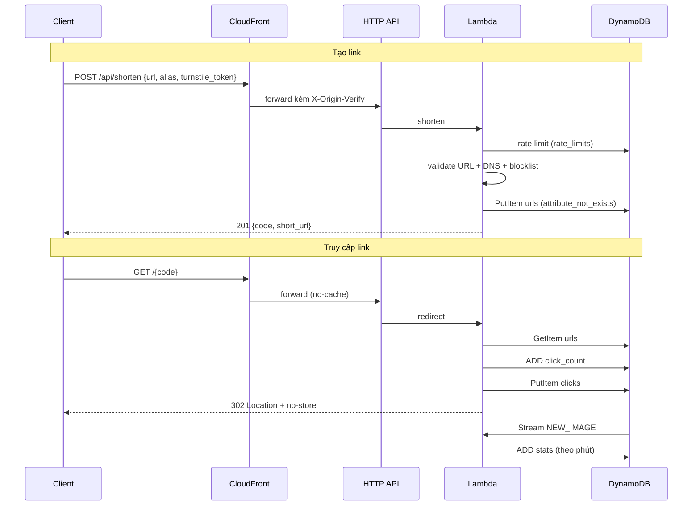

# Architecture — LinkPulse

> **Module:** TV5 · **Issue:** #11 (tuần 2)
> **Stack:** `CloudFront (+ WAF tùy chọn) → API Gateway HTTP API → Lambda Python 3.11 → DynamoDB`
> **Đọc cùng:** `docs/api_spec.yaml`, `docs/backend_research.md`, `docs/analytics_research.md`,
> `docs/database_design.md`, `docs/QUYET_DINH_CHOT_TUAN_2.md`, `docs/threat_model.md`, `docs/security_research.md`
> **Trạng thái:** mô tả theo code thật trong `backend/src/` và `backend/template.yaml`

---

## 1. Tổng quan

Hệ thống rút gọn liên kết serverless, tách làm hai phần để mỗi phần tối ưu riêng:

- **Luồng nóng** (`GET /{code}`): đọc một item DynamoDB, trả `302`. Mọi thứ khác đều đẩy ra sau.
- **Luồng lạnh** (ghi thống kê): ghi click vào bảng `clicks`, DynamoDB Stream kéo `process_clicks`
  cộng dồn theo phút vào bảng `stats`.

**Nguyên tắc:**

1. **Edge-first.** Mọi request đi qua CloudFront. WAF chặn ở biên trước khi chạm origin.
2. **Redirect không cache.** `GET /{code}` trả `302 + Cache-Control: no-store`, CloudFront dùng
   `Managed-CachingDisabled`. Mỗi click đều phải qua server để đếm.
3. **Ghi cạnh tranh an toàn.** Tạo link bằng `PutItem` kèm
   `ConditionExpression: attribute_not_exists(short_code)`. Mã đã xoá không được cấp lại.
4. **Chống lạm dụng nhiều lớp.** WAF → throttling của API Gateway → rate limit theo IP trong
   DynamoDB → chặn domain → đánh dấu link đáng ngờ.
5. **Không lưu PII.** Click event chỉ lưu `ip_hash` (16 ký tự hex, HMAC có salt), không lưu
   `user_agent` và không lưu IP thật.

**Region:** workload ở `ap-southeast-2` (Sydney). Tài khoản Free plan kiểu mới bị AWS ghim Region
theo project; TV1 đã bị chặn ở `ap-southeast-1` (`docs/backend_research.md` §6.2). Stack edge dùng
CloudFront nên deploy ở `us-east-1`. WAF phạm vi `CLOUDFRONT` chỉ tạo được ở `us-east-1`.

---

## 2. Sơ đồ tổng thể

```mermaid
flowchart TB
    subgraph Client["Client"]
        UI["Giao diện tĩnh<br/>S3 + CloudFront<br/>index / dashboard / links<br/>protection / warning / error"]
    end

    subgraph Edge["Biên — us-east-1"]
        WAF["AWS WAF Web ACL<br/>scope CLOUDFRONT<br/>① ShortenRateLimit<br/>② GlobalRateLimit<br/>③ AmazonIpReputation<br/>④ CommonRuleSet<br/>(EnableWaf, mặc định false)"]
        CF["CloudFront<br/>/api/* → HTTP API<br/>/{code} → HTTP API<br/>/css /js /mock /assets /vendor → S3<br/>/*.* → S3<br/>+ header X-Origin-Verify"]
    end

    subgraph GW["API Gateway — HTTP API"]
        RT1["POST /api/shorten<br/>throttle 10 rps / burst 20"]
        RT2["GET /{code}<br/>throttle 100 rps / burst 200"]
        RT3["GET,DELETE /api/links<br/>GET /api/stats"]
    end

    subgraph Compute["Lambda — Python 3.11 arm64, 256 MB"]
        LShort["shorten<br/>validate → Turnstile → blocklist<br/>→ PutItem urls"]
        LRedir["redirect<br/>GetItem urls → check trạng thái<br/>→ ADD click_count → ghi clicks<br/>→ 302 no-store"]
        LLinks["links<br/>Query GSI owner-index<br/>DELETE: xoá mềm + dọn thống kê"]
        LStats["stats<br/>Query stats theo scope/sk"]
        LProc["process_clicks<br/>Stream NEW_IMAGE, INSERT<br/>→ cộng dồn stats theo phút<br/>→ gắn cờ link bất thường"]
    end

    subgraph Data["DynamoDB — provisioned, TTL, Streams"]
        TUrls[("urls<br/>PK short_code<br/>GSI owner-index (owner_id, created_at)")]
        TClicks[("clicks<br/>PK short_code, SK sk=ts#id<br/>TTL 30 ngày, Stream NEW_IMAGE")]
        TStats[("stats<br/>PK scope (GLOBAL/LINK#code/META)<br/>SK sk=M#phút<br/>TTL 8 ngày")]
        TRate[("rate_limits<br/>PK pk=loại#ip_hash#cửa sổ")]
        TBlock[("blocklist<br/>PK domain")]
    end

    subgraph Ops["Vận hành"]
        SSM["SSM Parameter Store<br/>SecureString: origin-verify,<br/>turnstile-secret"]
        SQS["SQS DLQ<br/>lỗi xử lý stream"]
        CW["CloudWatch<br/>alarm DLQ"]
        BUD["AWS Budget $5/tháng"]
    end

    UI -->|HTTPS| WAF
    WAF -->|allow| CF
    CF -->|/api/shorten| RT1
    CF -->|/api/*| RT3
    CF -->|/{code}| RT2
    RT1 --> LShort
    RT2 --> LRedir
    RT3 --> LLinks
    RT3 --> LStats
    LShort --> TUrls
    LShort --> TRate
    LShort --> TBlock
    LRedir --> TUrls
    LRedir --> TClicks
    LRedir --> TRate
    LLinks --> TUrls
    LLinks --> TClicks
    LLinks --> TStats
    LStats --> TStats
    TClicks -->|Streams NEW_IMAGE| LProc
    LProc --> TStats
    LProc -->|gắn cỏ| TUrls
    LProc -->|lỗi| SQS
    SQS --> CW
    LShort -.->|đọc bí mật| SSM
    LRedir -.->|đọc SSM origin-verify| SSM
    BUD -.->|cảnh báo mail| CW
```

### Luồng tạo link và luồng redirect



---

## 3. Data flow

### 3.1. Tạo link — `POST /api/shorten`

| Bước | Xử lý | Lỗi |
|---|---|---|
| 1. Biên | CloudFront forward `/api/*` (không cache), kèm `X-Origin-Verify`; WAF kiểm tra rate-based `/api/shorten` và managed rule set | Vượt ngưỡng → 403 từ WAF |
| 2. API Gateway | Throttle route `POST /api/shorten`: 10 rps, burst 20 | 429 |
| 3. Rate limit theo IP | Ghi có điều kiện vào `rate_limits` (`shorten#<ip_hash>#<cửa sổ>`), mặc định 10 lần/phút | 429 + `Retry-After` |
| 4. Chặn trực tiếp | `origin.verify()` — request không có header `X-Origin-Verify` đúng sẽ bị 403 | 403 `forbidden` |
| 5. Validate đầu vào | `validate_url`: scheme `http`/`https`, cấm `user:pass@`, cấm khoảng trắng, dài ≤ 2048, cấm host của chính hệ thống, chặn IP literal nội bộ. `validate_shorten_input`: alias theo `^[A-Za-z0-9-]{3,30}$`, `expires_in` 60–31536000, `max_clicks` ≥ 1 | 400 `invalid_url` / `invalid_alias` / `invalid_expires_in` / `invalid_max_clicks` |
| 6. DNS | `check_dns`: phân giải A/AAAA, từ chối nếu bất kỳ địa chỉ nào thuộc dải nội bộ (chặn SSRF) | 400 `invalid_url` với reason `host_not_allowed` / `host_unresolvable` |
| 7. Captcha | `turnstile.verify` gọi `siteverify` của Cloudflare (chỉ khi `TurnstileSecretParam` được đặt) | 400 `captcha_failed` |
| 8. Độ tin cậy | `reputation.is_blocked`: tra `blocklist` theo host và domain cha, có thể hỏi Google Safe Browsing nếu đặt key. `suspicious_reasons`: IP literal, punycode, nhiều subdomain, TLD rủi ro, link rút gọn lồng nhau | 400 `blocked_domain` |
| 9. Ghi link | `PutItem urls` với `attribute_not_exists(short_code)`. Cùng chủ sở hữu và cùng URL còn active thì trả lại link cũ (200, `created:false`). Trạng thái `suspicious` nếu có dấu hiệu đáng ngờ | 409 `alias_taken`; hết lượt thử sinh mã → 500 |

### 3.2. Truy cập link — `GET /{code}`

| Bước | Xử lý | Kết quả |
|---|---|---|
| 1. Biên | Behavior `/{code}` không cache; WAF rate-based toàn domain | 403 khi vượt ngưỡng |
| 2. API Gateway | Throttle toàn API 100 rps, burst 200 | 429 |
| 3. Rate limit theo IP | `redirect#<ip_hash>#<cửa sổ>`, mặc định 300/phút (`REDIRECT_RATE_LIMIT=0` để tắt) | 429 + `Retry-After` |
| 4. Kiểm tra trạng thái | `GetItem urls`. Thứ tự: `deleted` → 404, `blocked` → 403, hết hạn → 410, đạt giới hạn click → 410, `suspicious` → 403 trừ khi có `?confirm=1` | 403 / 404 / 410 |
| 5. Đếm click | `ADD click_count` có điều kiện `< max_clicks` (atomic) | 410 nếu đã đạt giới hạn |
| 6. Ghi click event | `PutItem clicks`: `ip_hash` 16 hex, `country`, `device`, `browser`, `referrer`, `result` (`valid`/`bot`). TTL 30 ngày | Lỗi ghi không chặn redirect |
| 7. Trả về | `302 Location` + `Cache-Control: no-store` | — |

Khi `ErrorPageMode=redirect` và trình duyệt gửi `Accept: text/html`, lỗi trả `302` sang
`error.html` hoặc `warning.html` thay vì JSON.

### 3.3. Tổng hợp thống kê

`clicks` có DynamoDB Stream `NEW_IMAGE`. `process_clicks` xử lý batch tối đa 100 event, chỉ nhận
`eventName = INSERT`, cộng dồn vào `stats`:

- `scope = GLOBAL` cho toàn hệ thống, `scope = LINK#<code>` cho từng link, `scope = META` cho
  bộ đếm và danh sách click gần đây.
- `sk = M#<ISO phút>`; các bộ đếm phẳng `clicks`, `bot_clicks`, `c:<country>`, `d:<device>`,
  `b:<browser>`, `r:<referrer>`, `l:<code>` (chỉ ở GLOBAL), cùng tập `ips` để ước tính
  unique visitors.
- Cùng lúc đó `abuse.evaluate()` đối chiếu số click/phút với ngưỡng `SpikeClicksPerMinute`
  (mặc định 300) và tỉ lệ bot với `BotMinClicks` (mặc định 50) + `BotRatio` (mặc định 0.8).
  Vượt ngưỡng thì `urls.status` chuyển `suspicious` kèm `flag_reason`.
- Lỗi xử lý batch thì Lambda retry, hết số lần thì event vào SQS DLQ; CloudWatch alarm báo khi
  DLQ có message.

Độ trễ cập nhật dashboard vài giây (`MaximumBatchingWindowInSeconds = 2`).

### 3.4. Quản lý link

- `GET /api/links`: query GSI `owner-index` theo `X-Owner-Id`, lọc `status`, tìm theo `q`, phân
  trang bằng cursor (`LastEvaluatedKey`).
- `DELETE /api/links/{code}`: đánh dấu `status = deleted` (giữ mã, không cấp lại) và xoá click
  event cùng thống kê của link đó.
- Chặn / gỡ chặn domain: dùng `scripts/blocklist.sh` (hoặc `.ps1`). Hệ thống không có giao diện
  quản trị.

---

## 4. Interface giữa các module

### 4.1. HTTP API

| Method & Path | Request | Thành công | Lỗi chính |
|---|---|---|---|
| `POST /api/shorten` | `X-Owner-Id` · `{ url, alias?, expires_in?, max_clicks?, turnstile_token? }` | `201 { code, short_url, created, long_url, expires_at?, max_clicks? }` | 400 `invalid_url` / `blocked_domain` / `invalid_alias` / `invalid_expires_in` / `invalid_max_clicks` / `captcha_failed` · 409 `alias_taken` · 429 `rate_limited` |
| `GET /{code}[?confirm=1]` | path `code` | `302 Location` + `Cache-Control: no-store` | 403 `link_blocked` / `link_suspicious` · 404 `not_found` · 410 `link_expired` / `max_clicks_reached` |
| `GET /api/links` | `X-Owner-Id` · `status?` `q?` `sort?` `limit≤50` `cursor?` | `200 { summary, items, next_cursor? }` | 401 `unauthorized` |
| `DELETE /api/links/{code}` | `X-Owner-Id` | `204` | 401 / 403 `forbidden` / 404 |
| `GET /api/stats` | `from?` `to?` `granularity=minute\|hour` | `200 StatsResponse` | 400 · 429 |
| `GET /api/stats/{code}` | như trên | `200 StatsResponse` | 404 |
| `GET /api/health` | — | `200` | — |

Chuẩn lỗi: `{ "error": { "code", "message?", "reason?", "retry_after?" } }`. Mã lỗi đầy đủ xem
`docs/api_spec.yaml`.

### 4.2. DynamoDB

`backend/template.yaml` là nguồn sự thật của schema. Chế độ tính phí `PROVISIONED` để nằm trong
mức miễn phí.

| Bảng | Khoá | Ghi chú |
|---|---|---|
| `urls` | PK `short_code` · GSI `owner-index` (`owner_id`, `created_at`) | `status`, `long_url`, `owner_id`, `created_at`, `expires_at`, `max_clicks`, `click_count`, `flag_reason`, `flagged_at`. Xoá mềm giữ `status = deleted`. |
| `clicks` | PK `short_code` · SK `sk = <ts>#<id>` | TTL 30 ngày · Stream `NEW_IMAGE` là nguồn của pipeline. Chỉ lưu `ip_hash`, không lưu `user_agent`. |
| `stats` | PK `scope` (`GLOBAL` / `LINK#<code>` / `META`) · SK `sk = M#<phút>` | TTL 8 ngày · bộ đếm phẳng và tập `ips`. |
| `rate_limits` | PK `pk = <loại>#<ip_hash>#<cửa sổ>` | Ghi có điều kiện nguyên tử, TTL tự dọn. |
| `blocklist` | PK `domain` | Khớp cả domain cha (`a.b.bad.com` khớp `bad.com`). |

### 4.3. Edge ↔ Origin

- CloudFront forward `CloudFront-Viewer-Country`, `CloudFront-Viewer-Address`, `User-Agent`,
  `Referer`, `Accept`, `X-Owner-Id`; forward toàn bộ query string. Không forward `Cookie`.
- CloudFront gắn header `X-Origin-Verify` vào mọi request tới API. Backend đọc cùng bí mật từ
  SSM (`OriginVerifySecretParam`) và so sánh bằng `hmac.compare_digest`. Request thiếu hoặc sai
  header bị từ chối 403, nên không gọi thẳng `*.execute-api.amazonaws.com` để né WAF được.
  Bật bằng tham số `OriginVerifySecretParam`; để trống thì tắt (dùng cho dev).
- `IpHashSalt` truyền thẳng qua tham số template vào biến môi trường `IP_HASH_SALT` của Lambda
  (dùng làm khoá HMAC băm IP). Turnstile secret và Google Safe Browsing key nằm trong SSM
  SecureString, đọc qua `secrets_store.get_secret` và cache theo process.
- WAF ghi log vào bucket S3 (tham số `WafLogBucket`) khi bật.

---

## 5. Yêu cầu phi chức năng và giới hạn

| Yêu cầu | Mục tiêu | Đo bằng gì |
|---|---|---|
| Độ trễ redirect | p95 < 300 ms | CloudWatch `Duration` của `redirect` |
| Độ trễ tạo link | p95 < 800 ms (chưa tính verify captcha) | CloudWatch `Duration` của `shorten` |
| Độ trễ thống kê | vài giây sau click | `stats` đọc từ dashboard |
| Chi phí | < $5/tháng ở tải demo | AWS Budget + Cost Explorer |
| Quan sát được | Mọi lỗi có `error.code`; log CloudWatch theo request | CloudWatch Logs |

Giới hạn đã biết:

- `X-Owner-Id` là định danh do client tự sinh, chưa có xác thực thật (chưa dùng Cognito/JWT).
- Stream là at-least-once nên khi retry có thể đếm dư một ít.
- Tập `ips` trong một item `stats` bị giới hạn 400 KB; lưu lượng rất cao thì cần đổi sang
  HyperLogLog hoặc Kinesis.
- Safe Browsing và Turnstile là dịch vụ ngoài AWS, mặc định tắt; đây là lớp bổ sung, không thay
  thế WAF, throttling và rate limit.
- WAF có phí nên mặc định `EnableWaf=false`; bật khi kiểm thử rồi tắt.

---

## 6. Tham khảo

- Nhóm: `docs/api_spec.yaml`, `docs/database_design.md`, `docs/analytics_research.md`,
  `docs/backend_research.md`, `docs/QUYET_DINH_CHOT_TUAN_2.md`, `docs/threat_model.md`,
  `docs/security_research.md`.
- Code: `backend/template.yaml`, `backend/src/handlers/`, `backend/src/linkpulse/`,
  `infra/edge.yaml`.
- AWS: CloudFront behaviors và policies, WAF scope `CLOUDFRONT`, API Gateway HTTP API throttling,
  Lambda (env 4 KB, timeout), DynamoDB (conditional write, GSI, TTL, Streams), SSM Parameter Store
  SecureString, SQS DLQ, AWS Budgets.
