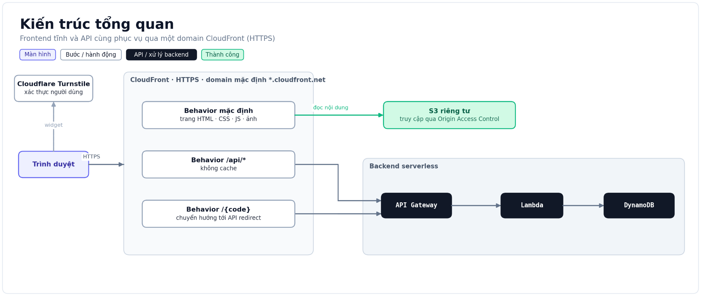
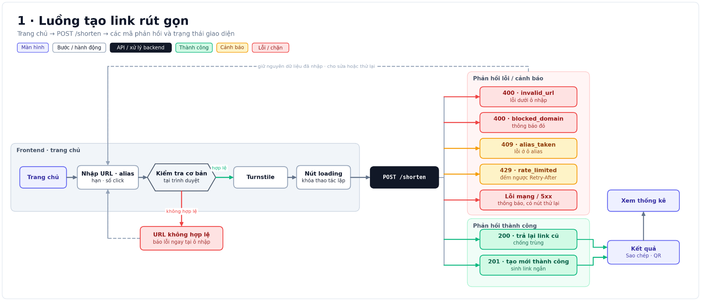
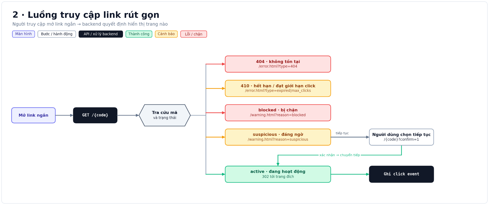
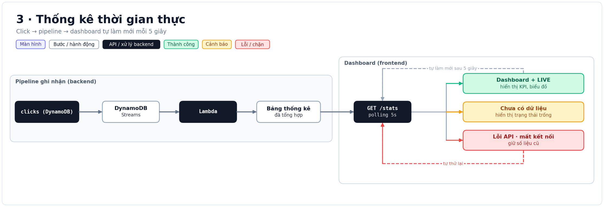
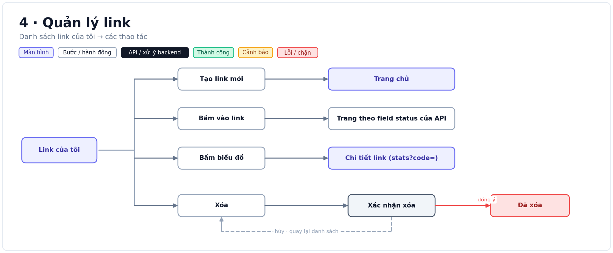

# Frontend & Presentation — (TV2)


## Quyết định chính

| Hạng mục | Đề xuất | Lý do |
|---|---|---|
| Hosting | S3 riêng tư + CloudFront/OAC | Bucket không public; CloudFront phục vụ giao diện qua HTTPS |
| Domain | Domain mặc định `*.cloudfront.net` | Có HTTPS sẵn, chưa cần mua domain riêng |
| Frontend | HTML, CSS, JavaScript thuần | Không cần build; phù hợp prototype và các trang static |
| Biểu đồ (đề xuất ban đầu) | Chart.js, đóng gói cùng ứng dụng | Vẽ được area/line và donut; không phụ thuộc CDN khi chạy |
| Chống bot | Cloudflare Turnstile | Backend xác minh token trước khi tạo link |
| Phát triển local | Static server và mock JSON | Làm giao diện trước khi API sẵn sàng |

## 1. Kiến trúc hosting và định tuyến



### S3 private và CloudFront/OAC

S3 lưu các file frontend tĩnh: HTML, CSS, JavaScript và ảnh. Bật **Block Public Access** cho bucket và dùng S3 REST endpoint làm origin. Tạo **Origin Access Control (OAC)** cho CloudFront, bật ký request SigV4, rồi cho phép đúng CloudFront distribution đọc object bằng bucket policy. Không dùng S3 website endpoint cho cấu hình này vì website endpoint không hỗ trợ OAC.

Tạo CloudFront distribution với S3 làm origin giao diện, đặt default root object là `index.html` và chọn viewer protocol policy **Redirect HTTP to HTTPS**. Domain mặc định `*.cloudfront.net` cung cấp HTTPS; chưa cần domain riêng hoặc certificate riêng cho giai đoạn demo.

### Behavior `/api/*` tới API Gateway

Thêm API Gateway làm origin thứ hai, dùng hostname HTTPS của API stage. Tạo cache behavior `/api/*` và đặt trên default behavior để rule API được ưu tiên.

| Behavior | Origin | Cache | Ghi chú |
|---|---|---|---|
| `/api/*` | API Gateway | **CachingDisabled** | Cho phép các HTTP method mà API sử dụng; chuyển tiếp body và query |
| `/assets/*`, `/vendor/*` | S3 private | TTL dài | Chỉ cache lâu khi file có version/hash trong tên |
| HTML (`/`, `/*.html`) | S3 private | TTL ngắn | Có thể đặt TTL bằng 0 hoặc vài giây để bản mới có hiệu lực nhanh |
| `/{code}` | API Gateway | **CachingDisabled** | Quyết định routing cùng TV1/TV5; xem lưu ý bên dưới |

Đối với `/api/*`, dùng cache policy **CachingDisabled**. Cấu hình origin request policy để chuyển tiếp các header, query string và cookie mà API thực sự cần; không chuyển tiếp tất cả một cách mặc định. Cho phép đúng các HTTP method API dùng, thường gồm `GET`, `POST`, `DELETE` và `OPTIONS` nếu cần preflight. CloudFront gọi API Gateway qua HTTPS, còn frontend dùng URL tương đối như `/api/shorten`; cùng domain giúp tránh CORS trong cấu hình này. Nếu frontend gọi trực tiếp hostname `execute-api`, backend phải cấu hình CORS riêng.

### Cache, deploy và invalidation

- Không cache request API hoặc redirect `/{code}`: response có thể thay đổi theo trạng thái link/người dùng, và cache có thể làm trả dữ liệu cũ.
- Đặt TTL ngắn cho HTML để cập nhật giao diện nhanh. Với asset đã version hóa, ví dụ `app.a1b2c3.js`, có thể đặt `Cache-Control: public, max-age=31536000, immutable`; khi nội dung đổi thì đổi tên file.
- Sau khi upload bản mới, invalidation các file giữ nguyên tên cần làm mới, thường là `/index.html` và các trang HTML đã đổi. Không invalidation `/*` nếu không cần.

Ví dụ triển khai (thay tên bucket và distribution ID bằng giá trị của nhóm):

```bash
aws s3 sync frontend/ s3://<bucket-frontend> --delete
aws cloudfront create-invalidation \
  --distribution-id <distribution-id> \
  --paths "/index.html" "/dashboard.html"
```

### Lưu ý routing

CloudFront không có pattern khớp chính xác “một path segment bất kỳ” cho mã `/{code}`. Cần thống nhất cách phân biệt mã link với trang và asset (ví dụ quy ước trang có đuôi `.html`, asset có prefix riêng, còn default behavior chuyển tới API). Kiểm thử `/`, trang HTML, asset, `/api/*`, mã hợp lệ và mã không tồn tại.

Nếu S3 private trả `403` khi object không tồn tại, không ánh xạ mọi `403` của distribution sang trang 404 một cách máy móc: có thể che mất lỗi/response 403 từ API, gồm cả trạng thái link bị chặn. Chỉ thêm custom error response sau khi kiểm tra hành vi API và routing thực tế.

Hosting S3 + CloudFront nằm trong free tier. Không dùng domain riêng.

## 2. Wireframe

Ảnh giao diện sản phẩm nằm trong [`screenshots/`](./screenshots/); mô tả chi tiết từng màn ở [gui_wireframe.md](./gui_wireframe.md).

| Nhóm màn | Tham chiếu | Nội dung |
|---|---|---|
| Tạo link | `01`–`03` | Form, kết quả tạo mới/link trùng, sao chép và trạng thái lỗi |
| Dashboard | `04`, `04b`, `04c` | KPI, biểu đồ, trạng thái trống/lỗi và thống kê theo mã |
| Cảnh báo | `08`, `09` | Link bị chặn hoặc đáng ngờ |
| Trang lỗi | `10`–`12` | Link không tồn tại, hết hạn hoặc đạt giới hạn click |

## 3. Luồng tạo link và phản hồi API



1. Người dùng nhập URL, alias (nếu có), hạn dùng và giới hạn click.
2. Frontend kiểm tra định dạng cơ bản. Dữ liệu không hợp lệ được báo ngay cạnh trường tương ứng và không gửi request.
3. Người dùng hoàn tất Turnstile. Frontend khóa nút để tránh gửi lặp, rồi gửi `POST /shorten`.
4. Thành công hiển thị link ngắn, thao tác sao chép và QR nếu API cung cấp. Giữ nguyên dữ liệu đầu vào nếu request thất bại.

| Phản hồi | UI đề xuất |
|---|---|
| `201` — tạo mới | Hiển thị link mới và hành động sao chép |
| `200` — link đã tồn tại | Hiển thị lại mã cũ, không tạo bản trùng |
| `400 invalid_url` | Báo lỗi tại ô URL |
| `400 blocked_domain` | Thông báo URL không được chấp nhận |
| `409 alias_taken` | Báo alias đã dùng và cho phép chọn tên khác |
| `429 rate_limited` | Hiển thị thời gian chờ từ `Retry-After` |
| Lỗi mạng hoặc `5xx` | Hiển thị thông báo dễ hiểu và nút thử lại |

Các mã và schema trên là đề xuất của luồng; cần thống nhất với TV1. Token Turnstile phải được backend xác minh, không coi việc widget hiển thị là bằng chứng xác thực.

## 4. Luồng truy cập link rút gọn



Backend xử lý `GET /{code}`, tra cứu link và quyết định phản hồi. Frontend hiển thị trang lỗi/cảnh báo theo kết quả; không tự suy đoán trạng thái link.

| Trạng thái | Kết quả dự kiến |
|---|---|
| Không tồn tại | `404` và `/error.html?type=404` |
| Hết hạn | `410` và `/error.html?type=expired` |
| Đạt giới hạn click | `410` và `/error.html?type=max_clicks` |
| Bị chặn | Trang `/warning.html?reason=blocked`; không chuyển tiếp tới đích |
| Đáng ngờ | Cảnh báo tại `/warning.html?reason=suspicious`; nếu được phép tiếp tục, người dùng xác nhận rồi gọi lại `/{code}?confirm=1` |
| Đang hoạt động | `302` tới URL đích và ghi nhận click event |

Status code và cơ chế xác nhận link đáng ngờ cần chốt với TV1/TV4 để không biến cảnh báo thành đường vòng bỏ qua chặn.

## 5. Thống kê và quản lý link



Luồng trong sơ đồ: click event được ghi vào DynamoDB; DynamoDB Streams kích hoạt Lambda để cập nhật bảng thống kê tổng hợp; dashboard gọi `GET /stats` định kỳ 5 giây. Frontend cần có ba trạng thái: hiển thị KPI/biểu đồ khi có dữ liệu, empty state khi chưa có dữ liệu, và báo lỗi khi API/mạng gặp sự cố. Khi polling lỗi, có thể giữ số liệu gần nhất và thử lại ở chu kỳ sau.



Từ danh sách Link của tôi, người dùng có thể tạo link mới, mở link để xem trạng thái do API trả về, mở thống kê theo mã, hoặc yêu cầu xóa. Xóa cần hộp thoại xác nhận; hủy quay lại danh sách, xác nhận mới gửi thao tác xóa. Backend chịu trách nhiệm kiểm tra quyền, ngừng redirect và xử lý dữ liệu liên quan.

## 6. Công nghệ và prototype

### Framework frontend

| Tiêu chí | HTML/CSS/JavaScript thuần | React + Vite |
|---|---|---|
| Quy trình chạy | Không cần build; dùng static server để phục vụ file | Chạy dev server khi phát triển; build ra `dist` trước khi deploy |
| Triển khai S3 | Đồng bộ trực tiếp thư mục frontend | Đồng bộ thư mục build `dist` |
| Tổ chức giao diện | Phù hợp vài trang và tương tác vừa phải; cần tự chia module | Component và trạng thái dùng chung thuận tiện khi ứng dụng lớn |

**Đề xuất hiện tại: HTML/CSS/JavaScript thuần.** Phạm vi ban đầu là website static, prototype nhỏ và các trang có thể tách thành file/module. Dùng ES modules nếu cần chia mã; khi chạy local, phục vụ qua static server (không mở trực tiếp bằng `file://`).

### Thư viện biểu đồ

| Thư viện | Framework phù hợp | Điểm mạnh | Điểm cần cân nhắc |
|---|---|---|---|
| **Chart.js** | JavaScript thuần hoặc React | Có line/area, bar, doughnut; API tương đối gọn; giấy phép MIT | Cần quản lý cập nhật và hủy chart khi đổi dữ liệu/trang |
| Recharts | React | Biểu đồ khai báo bằng component, tích hợp tự nhiên với React | Không phù hợp nếu giữ frontend thuần; thêm dependency React |
| Apache ECharts | JavaScript thuần hoặc React | Nhiều loại biểu đồ và tùy chọn tương tác | Nhiều tính năng hơn nhu cầu dashboard hiện tại; cần cân nhắc kích thước và độ phức tạp |

**Đề xuất nghiên cứu ban đầu là Chart.js**, vì dashboard cần biểu đồ click theo thời gian và donut thiết bị, còn top link/quốc gia/nguồn có thể dùng thanh CSS.

**Cập nhật triển khai tuần 2–3:** frontend hiện vẽ biểu đồ bằng SVG/DOM trong `frontend/js/charts.js`, không tải Chart.js hay thư viện biểu đồ ngoài. Lý do là số liệu cần hiển thị giới hạn, không cần thêm dependency, và dashboard đang dùng HTML/CSS/ES modules không có bước build. Nếu yêu cầu biểu đồ hoặc tương tác tăng lên, nhóm có thể quay lại quyết định Chart.js và cần ghi nhận thay đổi dependency. Chi tiết trạng thái triển khai, API mapping, chạy thử và checklist nằm trong [frontend_week2_3.md](./frontend_week2_3.md).

- Prototype tại `frontend/prototype/` dùng mock JSON, chỉ minh họa form rút gọn link, không gọi API production.

Chạy từ thư mục gốc repository:

```powershell
python -m http.server 8000 --directory frontend/prototype
```

Mở `http://localhost:8000`; đổi trạng thái bằng `?scenario=ok`, `duplicate`, `invalid_url`, `blocked_domain`, `alias_taken`, `rate_limited` hoặc `network`.

## Tài liệu liên quan

- [Wireframe](./gui_wireframe.md)
- [Frontend tuần 2–3: triển khai, API và kiểm thử](./frontend_week2_3.md)
- [Ảnh giao diện](./screenshots/)
- [Sơ đồ kiến trúc và luồng](./diagrams/)
- [Prototype](../frontend/prototype/)
