# Wireframe giao diện LinkPulse

Nguồn thiết kế: [Figma — URL Shortener, Giao diện TV2](https://www.figma.com/design/uZxwjbnDQeqpGBqXQbuwVc/URL-Shortener-%E2%80%94-Giao-di%E1%BB%87n-TV2--Serverless-AWS-?node-id=5-18).
Phân tích công nghệ, hosting và luồng frontend: [frontend_research.md](./frontend_research.md).

> Ảnh trong [`screenshots/`](./screenshots/) đã được chuẩn hóa chiều rộng 1920 px, giữ nguyên tỉ lệ và tăng độ sắc nét để dễ xem. Ảnh gốc người dùng cung cấp có độ phân giải thấp hơn nên thao tác này không khôi phục chi tiết không có trong nguồn. Đây là đặc tả UI; các dữ liệu, số liệu và URL trong ảnh là ví dụ, không phải dữ liệu API thật.

## Mục lục

- [Tạo link và trạng thái form](#tạo-link-và-trạng-thái-form)
- [Dashboard thống kê](#dashboard-thống-kê)
- [Link của tôi và xóa link](#link-của-tôi-và-xóa-link)
- [Chống lạm dụng (chỉ xem)](#chống-lạm-dụng-chỉ-xem)
- [Cảnh báo link](#cảnh-báo-link)
- [Trang lỗi link](#trang-lỗi-link)
- [Quy ước tích hợp](#quy-ước-tích-hợp)

---

## Tạo link và trạng thái form

### 01 — Trang chủ, form ban đầu

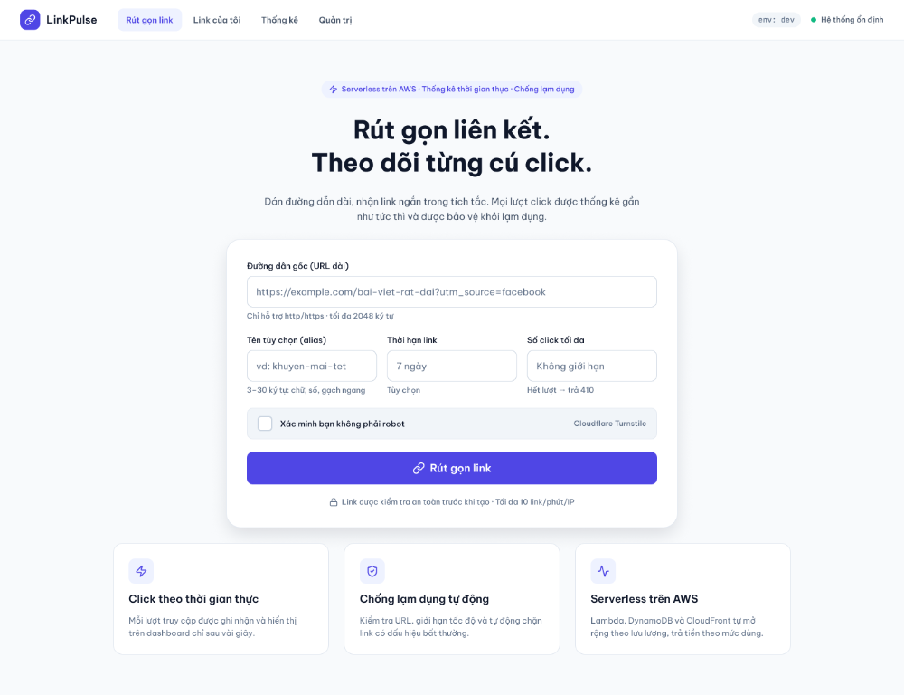

Trang đầu có thanh điều hướng LinkPulse, trạng thái hệ thống, phần giới thiệu và form rút gọn link.

| Thành phần | Nội dung |
|---|---|
| URL gốc | Bắt buộc; chỉ hỗ trợ `http`/`https`, tối đa 2048 ký tự |
| Alias | Tùy chọn; 3–30 ký tự chữ, số, gạch ngang |
| Thời hạn | Tùy chọn, mặc định hiển thị 7 ngày |
| Số click tối đa | Tùy chọn; không giới hạn nếu để trống |
| Chống bot | Checkbox Cloudflare Turnstile |
| Gửi form | Nút **Rút gọn link**; ghi chú giới hạn 10 link/phút/IP |
| Nội dung bổ trợ | Ba thẻ: click thời gian thực, chống lạm dụng, serverless AWS |

### 02 — Tạo link thành công

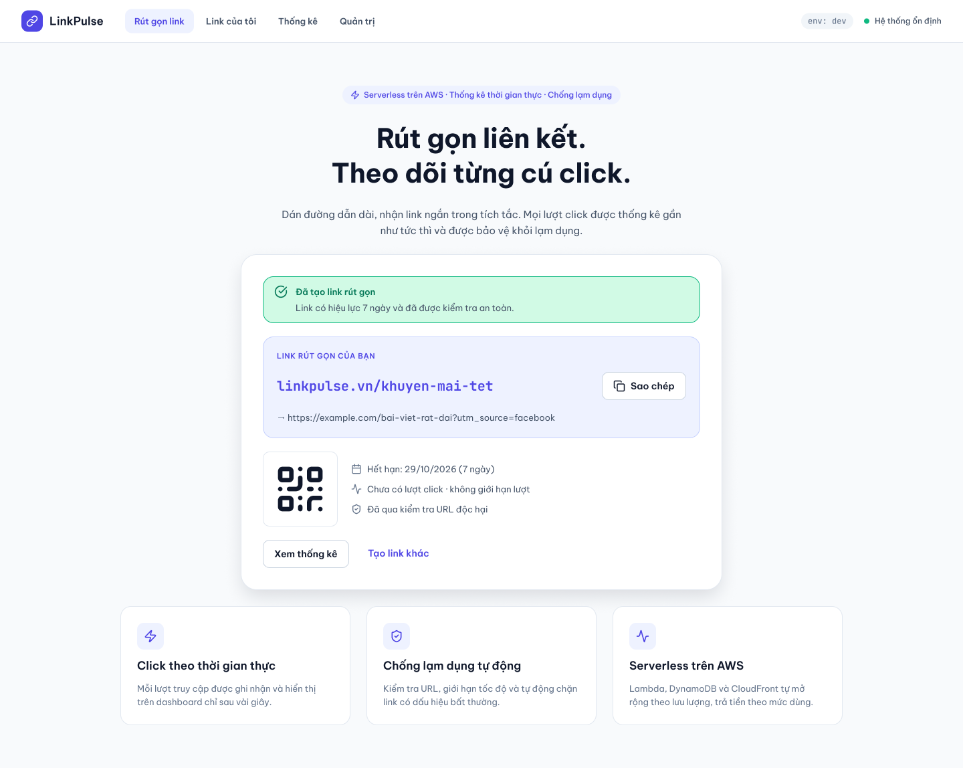

Kết quả thay form bằng banner thành công, mã link ngắn, nút sao chép, URL đích, QR, hạn dùng và thông tin lượt click. Có hành động **Xem thống kê** và **Tạo link khác**.

### 02b — URL đã được rút gọn trước đó

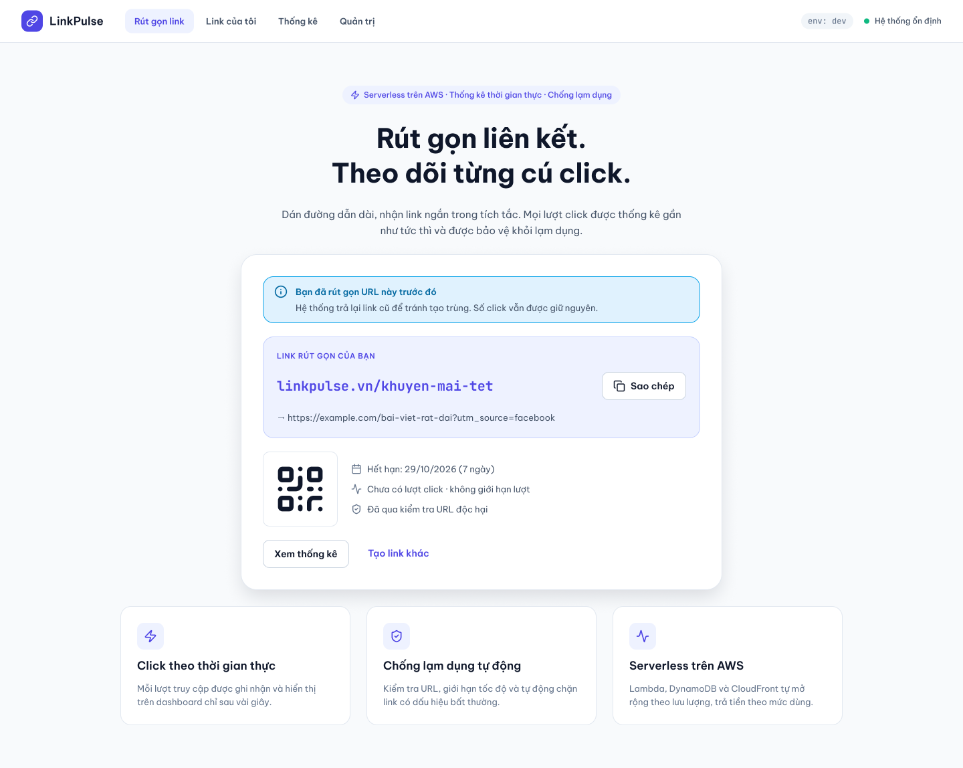

Thông báo màu xanh dương cho biết hệ thống trả lại link cũ thay vì tạo bản trùng; giữ nguyên mã link và số click đã có.

### 02c — Đã sao chép

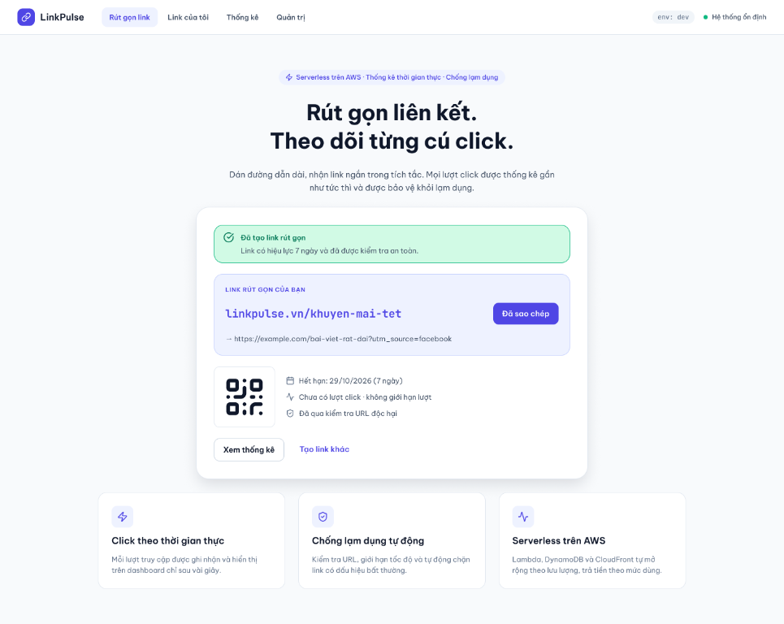

Sau thao tác sao chép, nút đổi thành **Đã sao chép**. Đây là phản hồi tạm thời, không thay đổi trạng thái hay dữ liệu của link.

### 03 — Loading, lỗi và giới hạn tốc độ

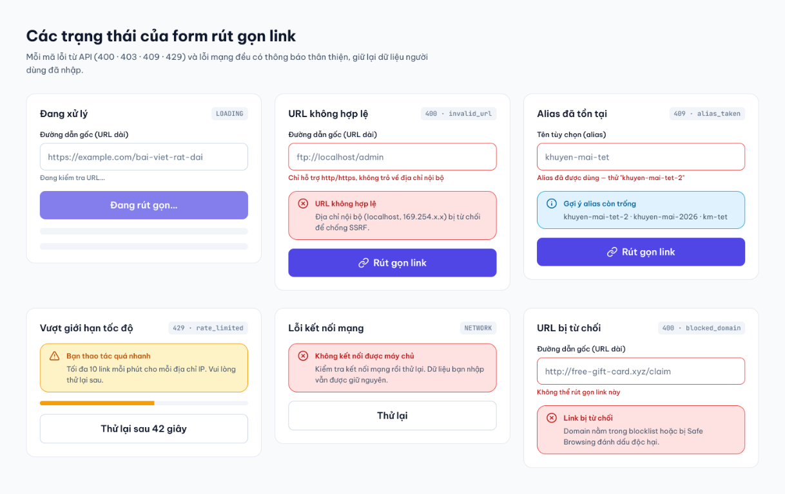

| Trạng thái | Nội dung cần thể hiện | Hành vi |
|---|---|---|
| Đang xử lý | Nút disabled “Đang rút gọn...”, chỉ báo kiểm tra URL và skeleton | Chặn gửi lặp, giữ nguyên dữ liệu |
| URL không hợp lệ | Viền và thông báo đỏ; từ chối URL nội bộ như `localhost`/`169.254.x.x` | Cho phép sửa URL |
| Alias đã tồn tại | Báo alias bị dùng và gợi ý các alias thay thế | Người dùng chọn alias khác |
| Vượt rate limit | Cảnh báo vàng, thanh thời gian và thời gian chờ | Chỉ thử lại khi hết đếm ngược |
| Lỗi mạng | Cảnh báo không kết nối được và nút **Thử lại** | Giữ lại dữ liệu đã nhập |
| Domain bị từ chối | Báo link nằm trong blocklist hoặc bị Safe Browsing đánh dấu | Yêu cầu URL khác |

Mã lỗi API đề xuất được ghi ở [frontend_research.md](./frontend_research.md); cần thống nhất với backend trước khi tích hợp.

---

## Dashboard thống kê

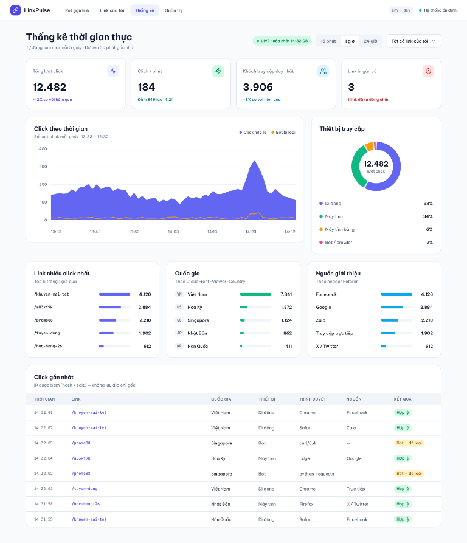

Dashboard tự làm mới theo thời gian thực, có nhãn LIVE, thời điểm cập nhật, bộ lọc khoảng thời gian và bộ lọc link.

| Khu vực | Nội dung |
|---|---|
| Thẻ KPI | Tổng lượt click, click/phút, khách truy cập duy nhất, link bị gắn cờ |
| Biểu đồ | Click hợp lệ và bot bị loại theo thời gian |
| Phân bố thiết bị | Biểu đồ donut: di động, máy tính, máy tính bảng, bot/crawler |
| Top link | Các mã link có nhiều click nhất |
| Quốc gia | Phân bố theo CloudFront-Viewer-Country |
| Nguồn giới thiệu | Facebook, Google, Zalo, trực tiếp, X/Twitter |
| Click gần nhất | Thời gian, link, quốc gia, thiết bị, trình duyệt, nguồn, kết quả |

IP được băm; không hiển thị hoặc lưu IP gốc trong bảng sự kiện theo đặc tả hiện tại.

### 04b — Trạng thái tải, trống và lỗi

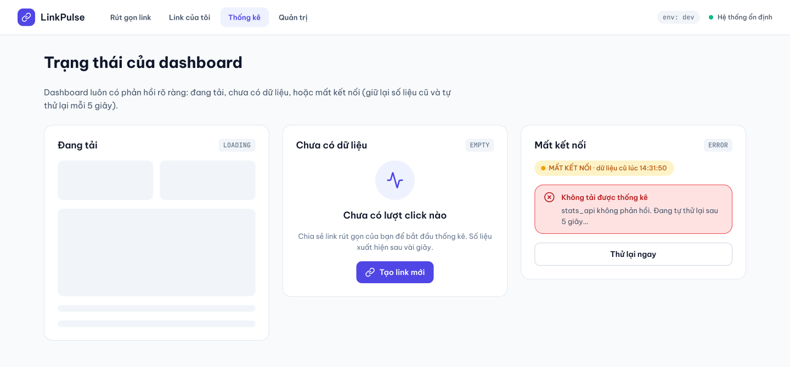

Thể hiện trạng thái đang tải, chưa có dữ liệu và lỗi/mất kết nối riêng biệt; không trình bày dữ liệu mẫu như số liệu thật. Nếu đã có dữ liệu trước khi mất kết nối, có thể giữ số liệu cuối cùng và đánh dấu thời điểm dữ liệu.

### 04c — Thống kê chi tiết theo mã link

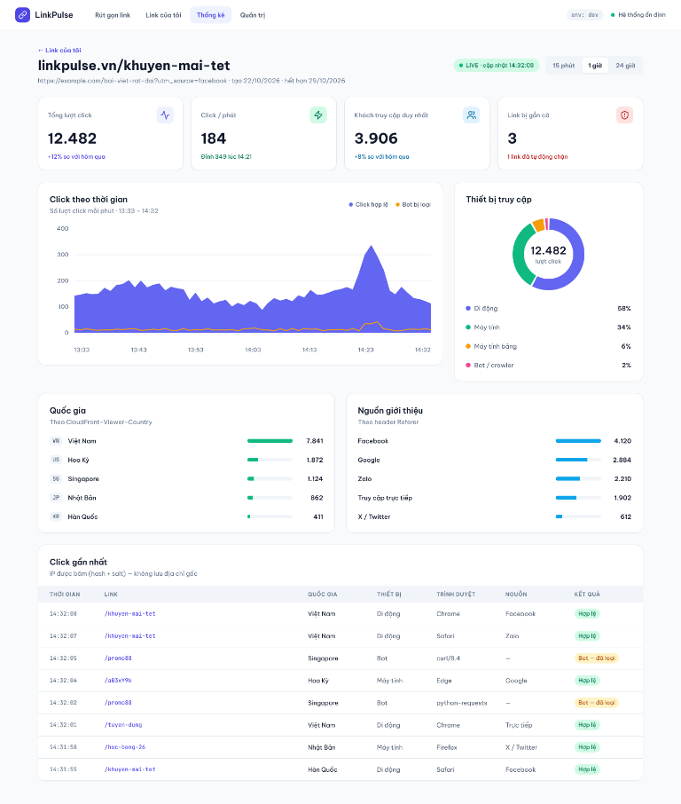

Giữ cấu trúc dashboard nhưng giới hạn dữ liệu vào một link: tiêu đề và URL đích của mã, chọn khoảng thời gian, KPI, biểu đồ click, thiết bị, quốc gia, nguồn giới thiệu và bảng click gần nhất. Có đường quay lại **Link của tôi**.

---

## Link của tôi và xóa link

### 05 — Danh sách link

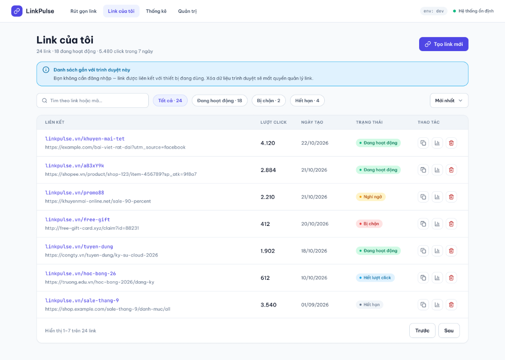

Trang hiển thị tổng số link, số link đang hoạt động và tổng click; có nút tạo link mới, ô tìm kiếm, bộ lọc trạng thái và sắp xếp. Bảng gồm mã/link đích, lượt click, ngày tạo, trạng thái và thao tác sao chép, xem thống kê, xóa. Có phân trang.

Các trạng thái mẫu: **Đang hoạt động**, **Nghi ngờ**, **Bị chặn**, **Hết lượt click**, **Hết hạn**.

Banner thông tin cho biết danh sách gắn với trình duyệt hiện tại; xóa dữ liệu trình duyệt sẽ làm mất quyền quản lý các link đó. Đây không phải xác thực tài khoản.

### 05b — Chưa có link

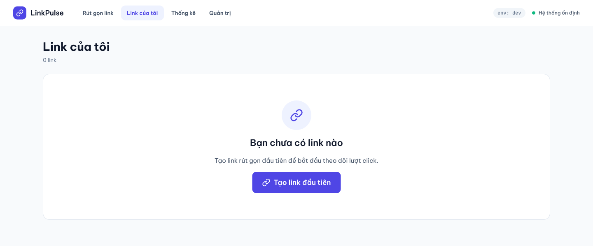

Empty state nêu rõ chưa có link và có CTA **Tạo link đầu tiên**.

### 05c — Link đã xóa

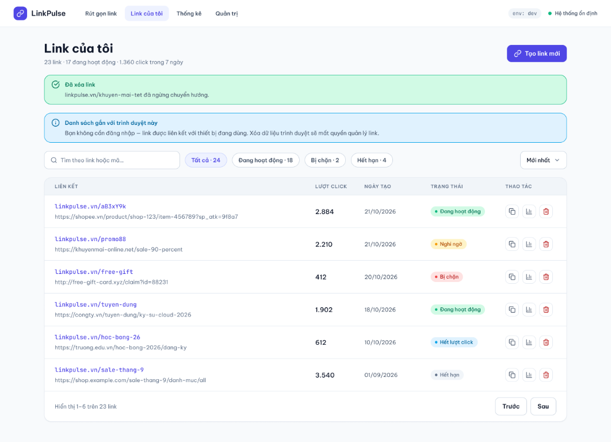

Sau khi xóa thành công, thông báo cho biết link đã ngừng chuyển hướng; danh sách được làm mới và hiển thị số liệu còn lại.

### 06 — Hộp thoại xác nhận xóa

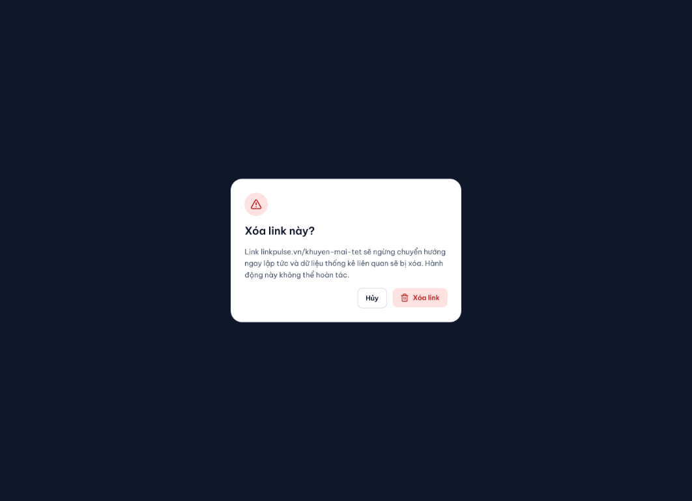

Hộp thoại nêu link sắp xóa và cảnh báo thao tác không thể hoàn tác, dữ liệu thống kê liên quan cũng bị xóa. Có hai lựa chọn **Hủy** và **Xóa link**; chỉ gọi thao tác xóa sau khi người dùng xác nhận.

---

## Chống lạm dụng (chỉ xem)

### 07 — Chống lạm dụng (chỉ xem)

Trang chỉ xem danh sách link đáng ngờ hoặc bị chặn, số lượng tổng hợp và các lớp bảo vệ đang áp dụng.

Danh sách lớp bảo vệ gồm validate URL, rate limit, blocklist domain, phát hiện link đáng ngờ và AWS WAF nếu đã được bật. Không có nút chặn, bỏ qua hoặc gỡ chặn; mọi thay đổi trạng thái do backend/security xử lý.

---

## Cảnh báo link

| `08` — Link bị chặn | `09` — Link đáng ngờ |
|---|---|
| 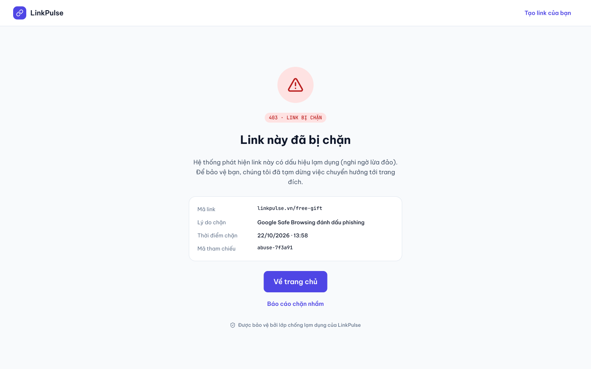 | 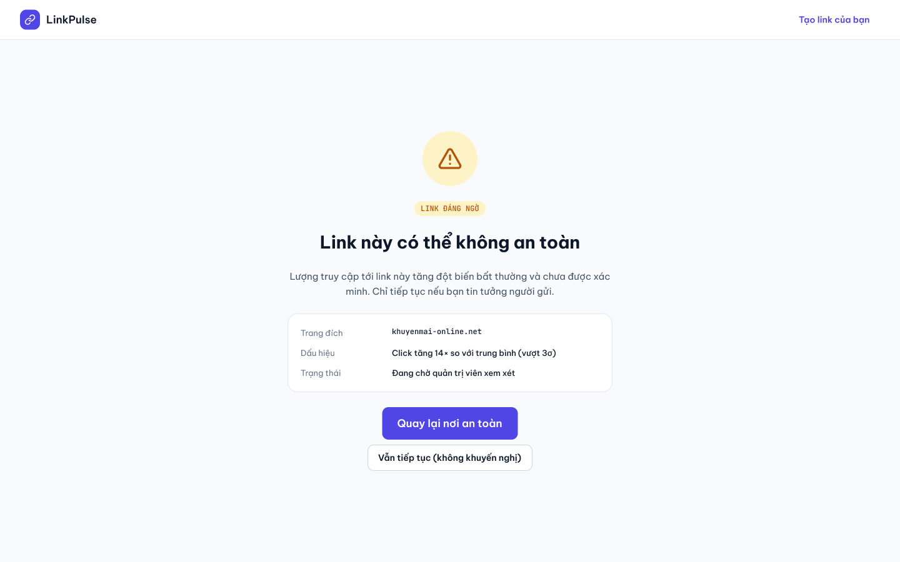 |

| Trạng thái | Mục đích | Hành động |
|---|---|---|
| `08` Bị chặn | Giải thích link đã bị chặn, nêu lý do/thông tin tham chiếu | Quay về trang chủ hoặc báo chặn nhầm |
| `09` Đáng ngờ | Cảnh báo rủi ro và cho biết link cần xem xét | Quay lại nơi an toàn; tiếp tục nếu thiết kế/backend cho phép |

Trang cảnh báo bị chặn không được chuyển tiếp người dùng tới đích. Cần chốt hợp đồng backend cho trạng thái `suspicious` và hành động tiếp tục.

---

## Trang lỗi link

| `10` — Không tìm thấy | `11` — Hết hạn | `12` — Hết lượt click |
|---|---|---|
|  | 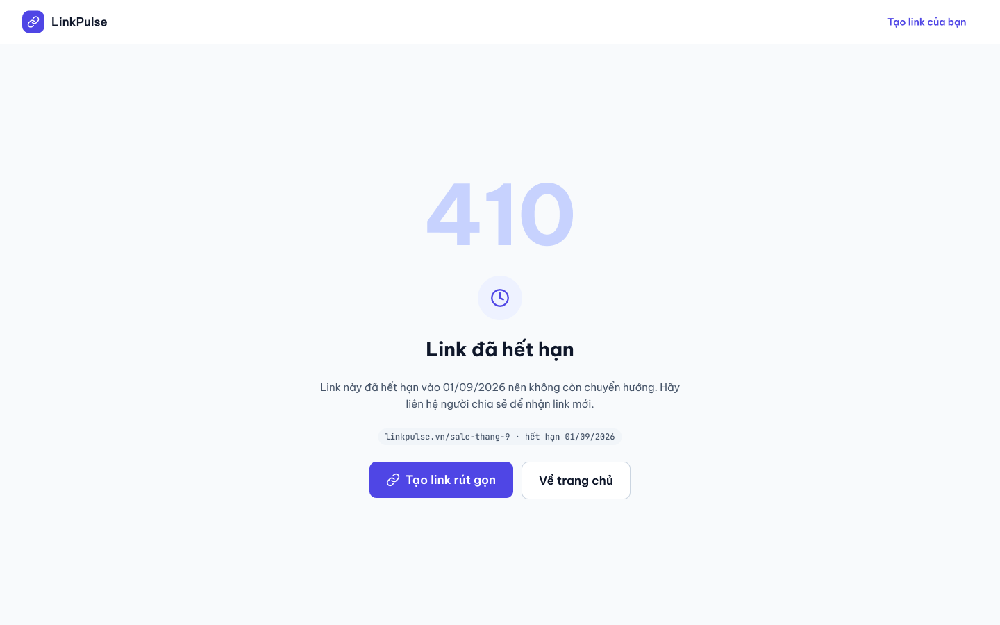 | 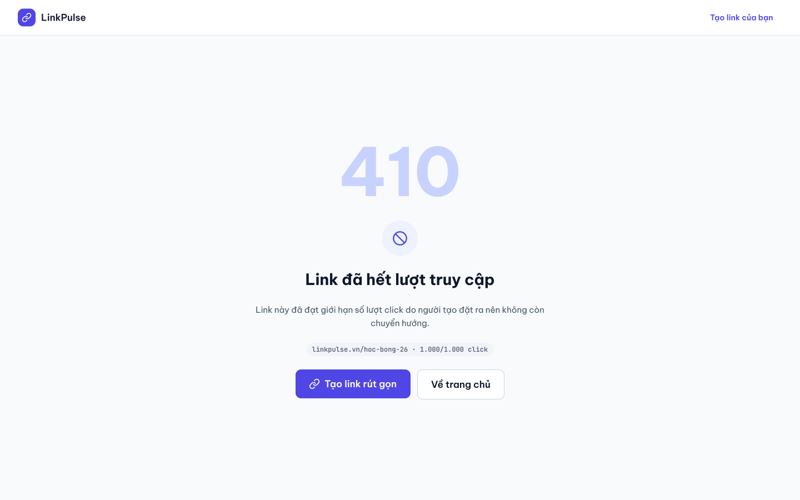 |

| Trạng thái | URL trang hiển thị đề xuất | HTTP đề xuất | Nội dung |
|---|---|---:|---|
| Không tìm thấy | `/error.html?type=404` | `404` | Không tìm thấy link; có thể tạo link mới hoặc về trang chủ |
| Hết hạn | `/error.html?type=expired` | `410` | Link đã hết hạn; về trang chủ |
| Hết lượt click | `/error.html?type=max_clicks` | `410` | Link đã đạt giới hạn click; về trang chủ |

Các URL và mã HTTP là đề xuất tích hợp; cần thống nhất với API/router thực tế.

---

## Quy ước tích hợp

- Dùng nhãn trạng thái và nội dung thân thiện; không hiển thị lỗi thô, token hoặc thông tin nội bộ từ API.
- Giữ dữ liệu form khi có lỗi mạng/validation để người dùng sửa hoặc thử lại.
- Trạng thái quản lý link được lưu gắn với trình duyệt theo thiết kế hiện tại; không coi `owner_id` phía client hay header `X-Owner-Id` là cơ chế xác thực.
- Tất cả hành động quản trị, chặn/gỡ chặn và xóa link phải được xác thực, phân quyền và kiểm tra lại ở backend.
- Làm rõ các mã lỗi, chính sách xóa dữ liệu và luồng `suspicious` với các nhóm API/security trước khi triển khai.
